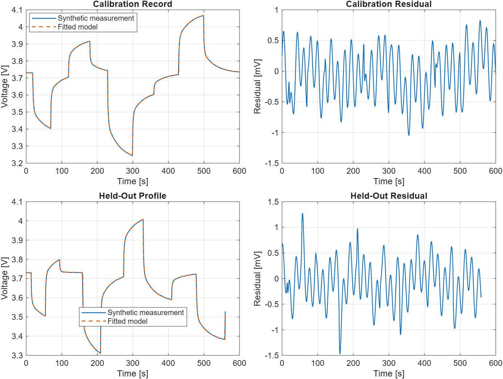

<!-- markdownlint-disable MD013 -->

# A Reproducible Two-RC Battery Parameter-Identification Workflow in MATLAB

An equivalent-circuit model is useful when its assumptions, fitted parameters,
and validation record can all be inspected. This tutorial walks through the
toolbox-free two-RC workflow in MATLAB Simulink Energy Lab: fit the model on
one pulse record, then test it on a separate pulse record that was not used to
choose the parameters.

> The included records are deterministic synthetic benchmarks. They demonstrate
> the workflow; they do **not** establish accuracy for a physical cell.



## What the model represents

The terminal voltage is described by an OCV lookup, an instantaneous ohmic
drop, and two polarization branches:

```text
Vt = OCV - I*R0 - Vrc1 - Vrc2
```

For a zero-order-held current over one interval, each RC state is updated
exactly rather than by a coarse Euler approximation:

```text
Vrc_k,next = exp(-dt / tau_k) * Vrc_k
             + Rk * (1 - exp(-dt / tau_k)) * I

tau_k = Rk*Ck
```

The fast and slow branches represent different terminal-voltage relaxation
time scales. They are a compact engineering approximation, not a substitute
for an electrochemical or cell-specific model.

## Run the complete example

From the repository root, run the deterministic no-plot check:

```matlab
run('examples/battery-2rc-model/check_battery_2rc_fit.m')
```

Or open the plotted workflow:

```matlab
run('examples/battery-2rc-model/run_battery_2rc_fit.m')
```

The current reference benchmark reports:

| Record | RMSE |
| --- | ---: |
| Calibration pulse profile | 0.401 mV |
| Independent held-out pulse profile | 0.440 mV |

The fitted fast and slow time constants are 2.01 s and 33.88 s. The regression
check also requires positive fitted parameters, ordered time constants, a
well-conditioned resistance solve, deterministic results, and held-out error
below 1.5 mV.

## Why a held-out profile matters

A small residual on the same pulse record used for fitting can result from a
model following quirks of that record rather than its underlying dynamics.
Using a second record creates a clear separation:

1. Build a calibration table containing `time_s`, `current_A`, `ocv_V`, and
   `terminal_voltage_V`.
2. Fit only the calibration table with `fit_battery_2rc_parameters`.
3. Pass the fitted parameters and a separate pulse table to
   `evaluate_battery_2rc_fit`.
4. Compare the held-out error with the pre-fit baseline and inspect the
   residuals.

The repository's check requires fitting to reduce held-out RMSE by at least
half relative to its deliberately imperfect initial parameter set. That is a
stronger teaching signal than reporting only a calibration fit.

## Guided exercise: diagnose an ohmic-resistance error

The RMSE table summarizes a whole record. To connect a residual to the voltage
equation, first predict what happens when **only** the fitted `r0_Ohm` increases
by `0.001` ohm (1 milliohm). Keep the pulse profile, OCV, SOC, both RC branches,
and measured voltage unchanged. Do not refit the parameters.

The evaluator defines residual as **measured minus predicted** voltage. Before
running the comparison, fill in the change in residual for these applied
currents from the synthetic held-out profile:

| Applied current | Operating point | Change in residual |
| ---: | --- | --- |
| +25 A | Discharge pulse | Predict the sign and magnitude |
| -30 A | Charge pulse | Predict the sign and magnitude |
| 0 A | Rest | Predict whether the added resistance changes it |

Use the existing [Chapter 3 reproduction exercise](../book/chapters/03-identification.md#exercise-3--codereproduction-calibration-versus-held-out)
and its [worked solution](../book/solutions/03-identification.md#exercise-3--codereproduction-solution)
to create `scenario`, `fitResult`, and `heldout` from the repository root.
Then run this extension in the same workspace:

```matlab
biasedParameters = fitResult.parameters;
biasedParameters.r0_Ohm = biasedParameters.r0_Ohm + 0.001;
biasedHeldout = evaluate_battery_2rc_fit( ...
    scenario.validation_data, biasedParameters);
deltaResidual_mV = 1000*(biasedHeldout.residual_V - heldout.residual_V);

figure('Name', 'Controlled R0 perturbation');
plot(heldout.time_s, deltaResidual_mV);
grid on;
xlabel('Time [s]');
ylabel('Change in residual [mV]');
```

This new plot shows the **change** caused by the controlled perturbation. The
figure at the top of this tutorial remains the original, unmodified fit.

<details>
<summary>Worked answer and interpretation</summary>

For the same model-applied current `I`, increasing `R0` by `deltaR0` lowers the
predicted terminal voltage by `I*deltaR0`. Because measured voltage is fixed,
the residual changes by the opposite amount:

```text
delta predicted voltage = -I * deltaR0
delta residual          = +I * deltaR0
```

The answers are **+25 mV**, **-30 mV**, and **0 mV**, respectively. Positive
current means discharge in this model. During rest, the RC states can still
relax and the original residual need not be zero; only the contribution from
this added ohmic resistance is zero. Compare changes in residual rather than
mistaking these values for the total residual.

A current-shaped residual is consistent with an ohmic-resistance error in this
controlled example. It is not a unique diagnosis on measured data: current
sensor bias, timing mismatch, OCV error, and omitted dynamics also need checking.

</details>

This is a synthetic diagnostic exercise, not a new physical-cell validation.
Keep the original fit frozen for the comparison. If you use a held-out record
to choose parameters, thresholds, or a model, it has become development data;
reserve a fresh final record before claiming independent validation.


## How the fitter stays toolbox-free

For a candidate pair of time constants, the branch responses are calculated
with unit resistance. The voltage drop is then linear in the three resistances:

```text
OCV - Vt = R0*I + R1*x1(tau1) + R2*x2(tau2)
```

The implementation searches ordered logarithmic time-constant candidates,
solves the three-resistance least-squares subproblem, rejects nonpositive or
ill-conditioned candidates, and refines around the best pair. Capacitances are
recovered from `C = tau / R`.

This structure makes the nonlinear part of the problem visible while keeping
the example runnable with base MATLAB.

## Before using measured cell data

Replace the synthetic records and illustrative parameters before drawing
cell-specific conclusions. In particular:

- estimate OCV independently instead of allowing the voltage fit to hide OCV
  error;
- use pulses that excite both expected time scales and a sampling interval
  appropriate to the fastest dynamics;
- keep a physically separate validation profile;
- check current sign, timestamp monotonicity, temperature, initial RC states,
  sensor bias, and hysteresis; and
- report parameter uncertainty and limitations alongside fit quality.

The model deliberately excludes joint OCV/capacity estimation, temperature
dependence, ageing, hysteresis, current bias, and cell-to-cell variation.

## Explore the runnable source

- [Two-RC model README](../examples/battery-2rc-model/README.md) — model
  scope, result fields, validation coverage, and limitations.
- [Fitting function](../examples/battery-2rc-model/fit_battery_2rc_parameters.m)
  — inspect the candidate search and constrained parameter selection.
- [Held-out evaluation](../examples/battery-2rc-model/evaluate_battery_2rc_fit.m)
  — compute voltage predictions and error metrics for any compatible record.
- [Native Simulink counterpart](../examples/battery-2rc-simulink-model/README.md)
  — generate and validate the two-branch block diagram against the exact
  MATLAB reference.

If this workflow saves setup time or helps teach validation, consider starring
the [repository](https://github.com/mohammadrezwankhan/matlab-simulink-energy-lab)
to help other energy-engineering learners find it.
